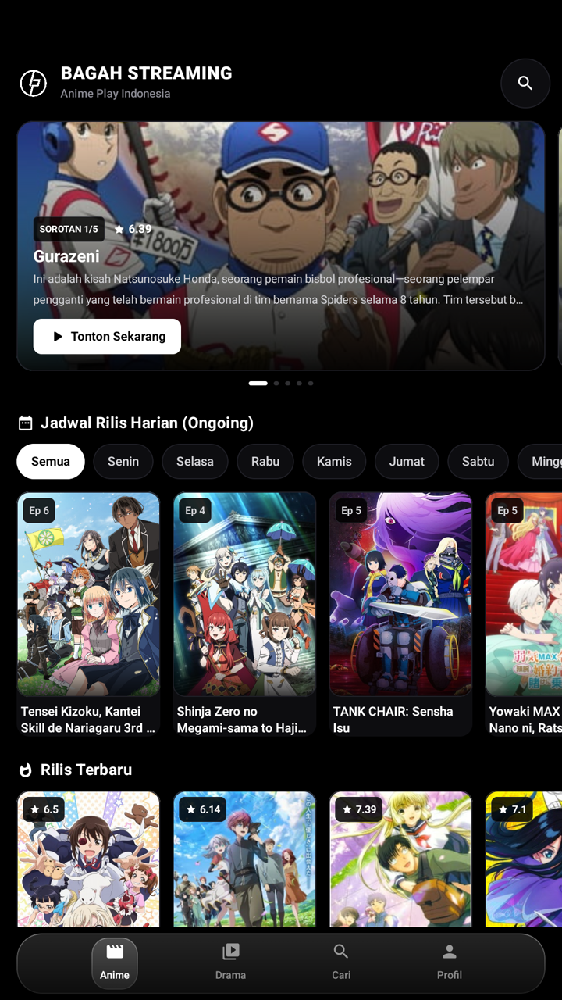
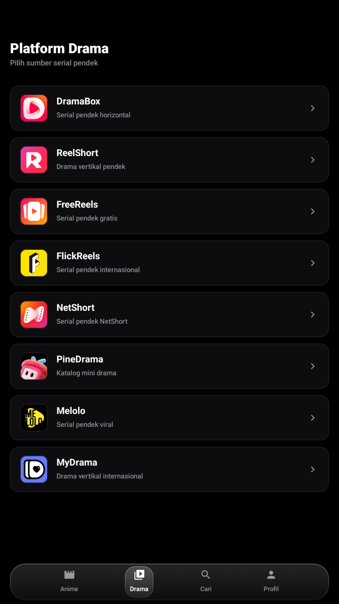
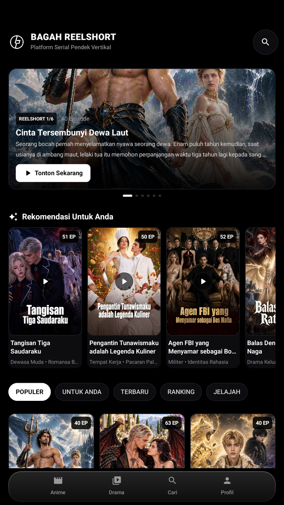
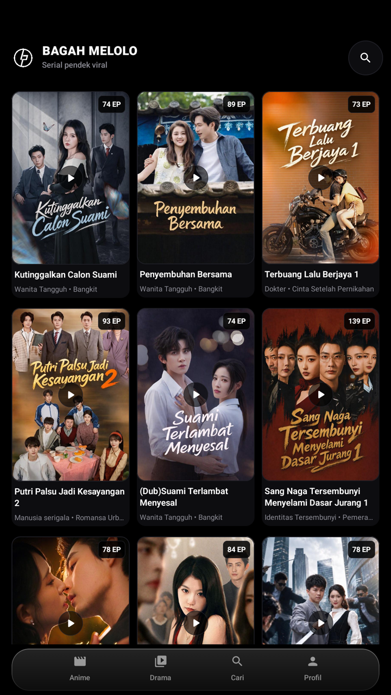
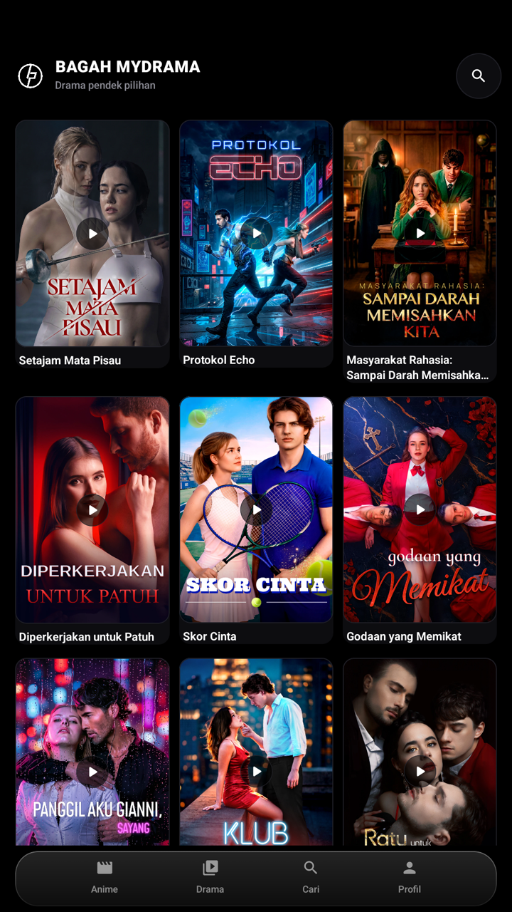
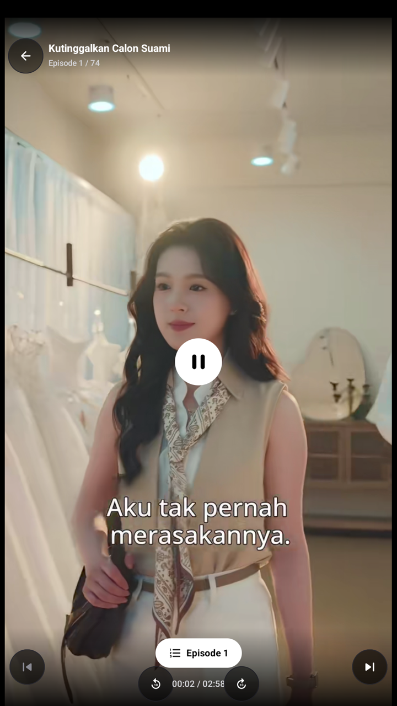
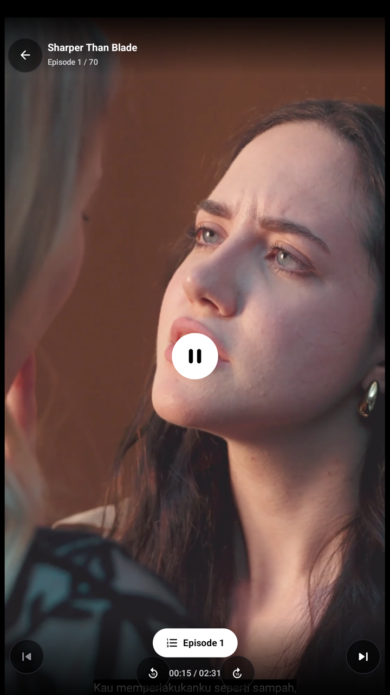

# Bagah Streaming

**English** | [Bahasa Indonesia](README.id.md)

An Android app for watching anime and short dramas from several platforms in one place.
Built with Kotlin and Jetpack Compose.

This repository uses the third-party `api.bagahproject.com` API and requires an API key to sign in.

## API Key

- **Free key for testing:** `dramakey` (limited quota, currently 10,000 requests).
- **Unlimited API key:** order at https://api.bagahproject.com/

Enter the key on the app's login screen. It is validated against the `check-key` endpoint and
stored locally, so you do not need to sign in again.

## Features

- **8 short-drama platforms**: DramaBox, ReelShort, FreeReels, FlickReels, NetShort, PineDrama, Melolo, MyDrama.
- **Anime Play Indonesia**: latest releases, ongoing shows with a daily schedule, movies, and recommendations.
- **API-key login**: validated against `check-key`; the session is persisted until app data is cleared or the app is uninstalled.
- **Profile screen**: account info (name, email, tier, role, quota), clear-cache button, and sign out.
- **Consistent player on every platform**: elapsed time, 10-second rewind/forward, auto-play next episode, and keep-screen-on.
- **Indonesian subtitles** automatically on FreeReels.
- **Cross-platform search** with pagination.
- **Per-platform filters**: DramaBox (status, genre, sort), ReelShort (ranking period, genre, region), FlickReels (sort, channel, region, tag), FreeReels (category), NetShort (ranking and channel).
- **Performance**: OkHttp disk cache + in-memory TTL cache per endpoint type, plus pull-to-refresh to force fresh data.

## Screenshots

<p>
  
  
  
</p>
<p>
  
  
  
  
</p>

Top: Anime home, drama platform list, and ReelShort home. Bottom: Melolo home, MyDrama home,
Melolo player (CENC decryption in the app), and MyDrama player with Indonesian subtitles.

## Platforms

| Platform   | Content                         | Playback                   |
| ---------- | ------------------------------- | -------------------------- |
| AnimePlay  | Anime (Indonesian subtitles)    | Media3 ExoPlayer           |
| DramaBox   | Short drama                     | Encrypted MP4 (per-sample AES-128-ECB decryption) |
| ReelShort  | Vertical short drama            | HLS                        |
| FreeReels  | Free short drama + subtitles    | HLS                        |
| FlickReels | International short drama       | HLS                        |
| NetShort   | NetShort short drama            | Direct MP4                 |
| PineDrama  | Mini-drama catalog              | Direct MP4                 |
| Melolo     | Viral short drama               | CENC AES-128-CTR MP4 (decrypted in the app) |
| MyDrama    | International vertical drama    | HLS + subtitles            |

## Tech Stack

- Kotlin 2.0, Jetpack Compose (Material 3)
- AndroidX Media3 ExoPlayer (MP4 and HLS)
- Retrofit + kotlinx.serialization
- OkHttp (API disk cache) + in-memory cache
- Coil (images)
- Navigation Compose
- MVVM with repositories

Min SDK 24, target/compile SDK 35.

## Getting Started

1. Open the project in Android Studio (JDK 21 recommended).
2. Build and install on a device or emulator:

   ```bash
   ./gradlew :app:assembleDebug
   ./gradlew :app:installDebug
   ```

3. Open the app, enter the API key on the login screen, and start watching.

## Login

- Enter the API key on the login screen. Free key for testing: `dramakey`. For unlimited access, order at https://api.bagahproject.com/ .
- The API key is validated through `GET /api/check-key`.
- The key is stored in `SharedPreferences` (name `bagah_session`) via `SessionStore`.
- `NetworkClient` uses the dynamic key; no key is hard-coded.

## Project Structure

```
app/src/main/java/com/bagah/streaming/
  data/
    api/          Retrofit service, NetworkClient, interceptors, and cache
    cache/        In-memory TTL cache
    model/        Per-platform data models
    player/       Decryption data sources for DramaBox and Melolo
    repository/   Per-platform and auth repositories
    session/      Session storage (API key)
  ui/
    components/   Shared components (cards, tabs, bottom nav, player controls)
    navigation/   Route definitions
    screens/      Feature screens (auth, profile, anime, per platform)
    theme/        Colors and typography
  MainActivity.kt
```

## Notes

- The app depends on a third-party API. Content availability and stability may change without notice.
- Some feeds (e.g. "For You" on ReelShort, Melolo, or MyDrama) expose a limited number of unique items because of the API's paged responses.
